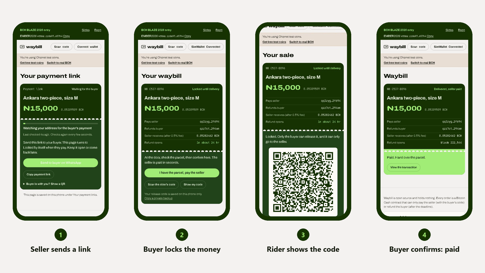
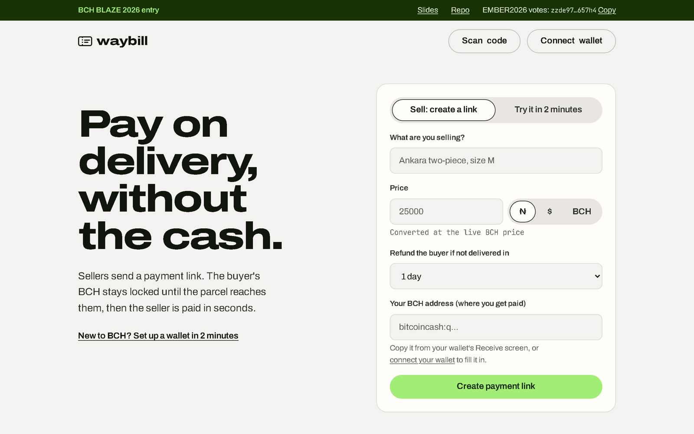

# Waybill

**Pay on delivery, without the cash.** A seller sends a payment link. The buyer's BCH is locked in a contract made for that one order. When the parcel arrives, the buyer confirms and the seller is paid, minus a 0.5% platform fee. If the parcel never comes, the money goes back to the buyer.

Live: https://efeaizesogie.github.io/waybill-cash/ · Built for BCH BLAZE 2026.



**[Watch the 90-second demo](docs/waybill-demo.mp4)**: the whole flow with voiceover, recorded on the live app (Chipnet test network, simulated wallet). **Install it on your phone** from the site: Install Waybill on your phone (Android) or Share, Add to Home Screen (iPhone).



## Why

Buying from strangers on WhatsApp and Instagram runs on trust nobody has. Buyers get "what I ordered vs what I got"; sellers stopped offering pay-on-delivery because riders carrying cash get robbed and failed deliveries cost them. Escrow apps exist, but each one is a company holding your money.

Waybill replaces the company with a Bitcoin Cash covenant. There is no arbiter, no account and no server.

## How it settles

| Step | Who | What happens |
| --- | --- | --- |
| Payment link | Seller | Item, price, their BCH address and a refund deadline become a link they send on WhatsApp. No wallet connection needed. |
| Lock | Buyer, via WizardConnect (Paytaca, Cashonize) | The buyer's phone creates a 16-byte release code and keeps it. The wallet sends BCH to a P2SH32 contract made for this order, plus a 546-sat "doorbell" output to the seller and an OP_RETURN note |
| Locked | Seller | The seller's page watches their own address, finds the doorbell, reads the note and rebuilds the contract. It turns to Locked by itself, with no server |
| Send to rider | Seller | A waybill link with no key in it. The rider can watch and show its QR, but can't move the money |
| Handover | Buyer | The buyer scans the rider's waybill QR, the order opens on their phone with the saved code, they check the parcel and confirm. `release` pays the seller. (Or the rider scans the buyer's code.) |
| No delivery | Anyone, after the deadline | `refund` is unlocked by block height; the covenant only pays the buyer |

Only the buyer ever holds the release code. If the seller or rider held it, they could pay themselves before delivering.

Release and refund need **no signatures**: the covenant enforces where the money goes, so the rider never connects a wallet.

## The contract

[`contracts/waybill-v2.cash`](contracts/waybill-v2.cash) (CashScript 0.14, 134 bytes), used for every new order:

- `release(secret)`: `sha256(secret) == releaseHash`, one input, output 0 is P2PKH to the seller. When 0.5% of the amount clears dust, exactly two outputs and output 1 pays at least 0.5% to the Waybill developer, taken from the seller's side; otherwise one output. The network fee is capped by `maxFee`.
- `refund()`: `tx.time >= refundAfter`, one input, one output, P2PKH to the buyer, no platform fee.

[`contracts/waybill.cash`](contracts/waybill.cash) is the original fee-free version; orders made with it keep working.

The secret is 128 bits and travels as a QR code. A short PIN would be brute-forceable, because the redeem script (and so the hash) is public.

The tests in [`test/`](test/) cover the fee (paid to the developer, can't be skipped, redirected, underpaid or used to shortchange the seller, none on refunds or dust-sized orders), paying the seller, a wrong code, redirecting the payout, burning it as fee, skimming with a second output, refunding early, refunding after the deadline, and redirecting the refund.

## No backend

Everything needed to rebuild the contract lives in the links (payment link, waybill link) and in the lock transaction's OP_RETURN note. The buyer's secret stays on their phone. The site is static on GitHub Pages and reads the chain through public Fulcrum servers.

## Run it

```bash
npm install
npm test
npm run dev
```

Add `?net=chipnet` to the URL to use Chipnet test coins. On Chipnet, tap **Get free test coins** to receive 0.005 test BCH from the built-in faucet (a Chipnet-only key in `src/lib/faucet.ts`; refill it by sending Chipnet coins to `bchtest:qqeps7k0vwmpncfggeks3z26fzl6g3csgqvdszr3f6`).

## Stack

React, Vite, TypeScript, CashScript 0.14, libauth, WizardConnect (`@wizardconnect/react`).
